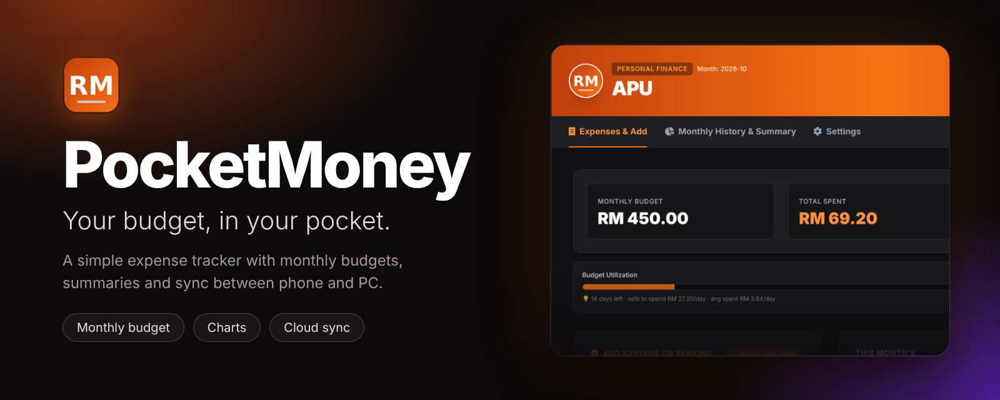
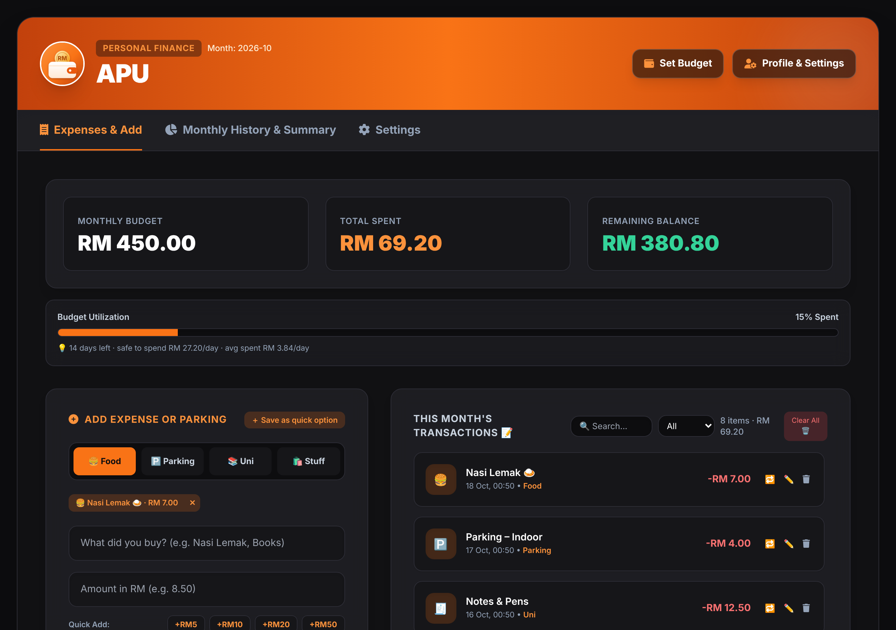
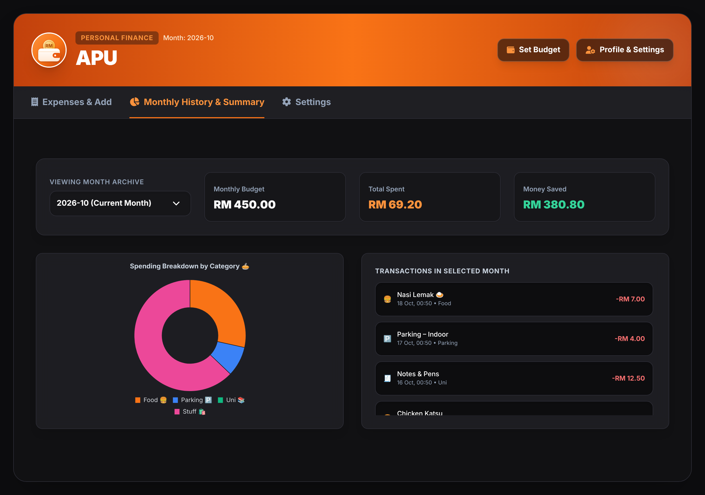

<p align="center">
  
</p>

<h1 align="center">PocketMoney</h1>

<p align="center">
  <b>Your budget, in your pocket.</b><br>
  A simple, fast expense tracker with monthly budgets, summaries and optional sync between phone and PC.
</p>

<p align="center">
  
  
  
  
  
  
</p>

<p align="center">
  <a href="https://jeffyboii.github.io/PocketMoney-Tracker/"><b>🚀 Open the app</b></a> ·
  <a href="#-install">Install</a> ·
  <a href="#-features">Features</a> ·
  <a href="#-cloud-sync">Cloud sync</a> ·
  <a href="#-run-your-own-copy">Run your own</a> ·
  <a href="CHANGELOG.md">Changelog</a> ·
  <a href="PRIVACY.md">Privacy</a>
</p>

---

## ✨ What is PocketMoney?

PocketMoney helps you stay on top of your spending without the clutter. Set a monthly budget, log food, parking, uni and other expenses in a couple of taps, and see exactly where your money went.

It runs entirely in the browser, installs like a native app, works offline, and can optionally sync between your phone and PC with a free account. No ads, no tracking, no sign-up required to get started.

<p align="center">
  
  
</p>

## 🎯 Features

**Track**
- **Monthly budget** with total spent, remaining balance and a progress bar
- **Safe-to-spend figure**: how much you can spend per day for the rest of the month, next to your actual daily average
- **Categories** for Food, Parking, Uni and Stuff, with an emoji for each
- **Quick add** buttons (+RM5, +RM10, +RM20, +RM50) and **saved quick options** for things you buy all the time
- **Repeat**, **edit** and **delete** any transaction, with **undo** if you slip
- **Search and filter** your transactions by category

**Review**
- **Monthly history**: browse any past month from the archive
- **Summary view** with money saved and a category breakdown chart

**Make it yours**
- Your name, profile picture, accent colour and wallpaper
- Dark and light mode
- Your own currency symbol

**Your data, your control**
- **Backups**: export and import JSON, export CSV for spreadsheets
- **Cloud sync** between devices (optional, free account)
- **Installable and offline**: behaves like a normal app

## 📲 Install

| Device | How |
|---|---|
| **Phone** | Open the link, then browser menu > *Add to Home Screen* (iPhone: Safari > Share > *Add to Home Screen*) |
| **PC** | Open the link in Chrome, Edge or Brave and click the install icon in the address bar |

## ☁️ Cloud sync

Without an account, your data stays in your own browser only. To sync:

1. Go to *Settings > Data Backup > Cloud Sync*
2. Create an account
3. Sign in with the same details on every device

Each account can only see its own data. See [PRIVACY.md](PRIVACY.md) for details.

> 💡 Cloud sync is completely optional. Skip it and everything stays on your device.

## 🛠️ Run your own copy

PocketMoney is a static site, so there is nothing to build.

1. **Fork** this repo and turn on GitHub Pages (*Settings > Pages > Deploy from branch `main`, `/ (root)`*).
2. **Optional, for cloud sync:** create a free [Supabase](https://supabase.com) project, run [`supabase-setup.sql`](supabase-setup.sql) in its SQL Editor, then copy your project URL and **anon** key into `config.js` (see [`config.example.js`](config.example.js)).
3. **Never** put a `service_role` key in this repo.

Leave `config.js` empty to run without cloud sync.

**Run locally:** serve the folder with any static server, for example:

```bash
python -m http.server 8000
```

then open `http://localhost:8000`. (Opening `index.html` straight from disk won't register the service worker, so use a local server to test install and offline mode.)

## 🧱 Built with

- Plain HTML, CSS and JavaScript, all in a single `index.html`
- [Chart.js](https://www.chartjs.org/) for the spending breakdown
- [Tailwind CSS](https://tailwindcss.com/) for styling
- [Supabase](https://supabase.com) for optional accounts and sync
- A web app manifest and service worker for install and offline support
- [Inter](https://rsms.me/inter/) font via Google Fonts

## 📝 Changelog

See [CHANGELOG.md](CHANGELOG.md) for what's new in each version.

## 🤝 Contributing

Found a bug or have an idea? [Open an issue](../../issues) or send a pull request. Small, focused changes are easiest to review.

## 📄 License

Released under the [MIT License](LICENSE).
